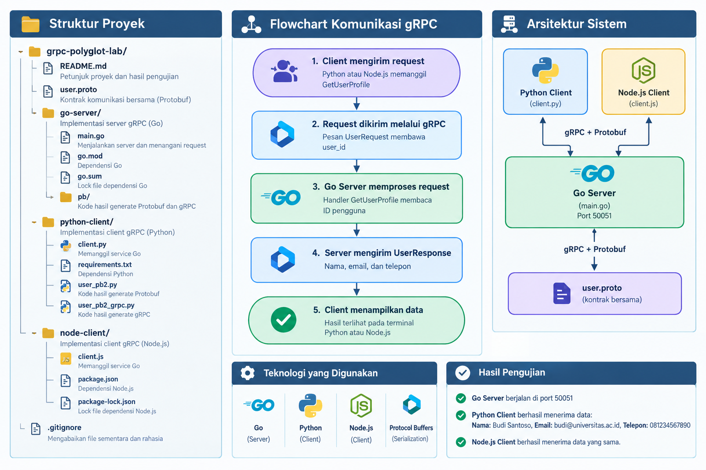

# Praktikum gRPC Polyglot

Implementasi praktikum **Komunikasi Inter-service dengan gRPC (Polyglot)** berdasarkan modul praktikum. Satu kontrak `user.proto` digunakan oleh Go Server, Python Client, dan Node.js Client. Versi ini juga menerapkan tugas evaluasi modul dengan menambahkan `phone = 3` pada `UserResponse`.

## 1. Arsitektur

- **Kontrak:** `user.proto` (Protocol Buffers / proto3)
- **Server:** Go, alamat `localhost:50051`
- **Client 1:** Python (`grpcio`)
- **Client 2:** Node.js (`@grpc/grpc-js`, `@grpc/proto-loader`)
- **RPC:** `GetUserProfile(UserRequest) returns (UserResponse)`

Data contoh `user_id = 1`:
- Nama: Budi Santoso
- Email: budi@universitas.ac.id
- Telepon: 081234567890

## 2. Prasyarat

Instal dan pastikan perintah berikut tersedia di terminal baru:
```bash
git --version
python --version
node --version
npm --version
go version
protoc --version
```
Gunakan Python 3.10 atau lebih baru, Node.js LTS, Go versi yang kompatibel dengan dependensi, dan Protocol Buffers Compiler (`protoc`). Untuk Go, pasang plugin generator:
```bash
go install google.golang.org/protobuf/cmd/protoc-gen-go@latest
go install google.golang.org/grpc/cmd/protoc-gen-go-grpc@latest
```
Pastikan folder tempat executable Go terpasang (biasanya `$(go env GOPATH)/bin`) masuk ke `PATH`.

## 3. Struktur proyek



## 4. Generate kode dari kontrak

Jalankan perintah dari folder root proyek `grpc-polyglot-lab`.

### Go
```bash
cd go-server
go mod tidy
protoc --proto_path=.. --go_out=. --go_opt=module=grpc-polyglot-lab/go-server --go-grpc_out=. --go-grpc_opt=module=grpc-polyglot-lab/go-server ../user.proto
cd ..
```
Hasil generator Go akan berada di `go-server/pb/`.

### Python
Windows PowerShell / CMD:
```powershell
py -m venv .venv
.venv\Scripts\activate
python -m pip install -r python-client/requirements.txt
python -m grpc_tools.protoc --proto_path=. --python_out=python-client --grpc_python_out=python-client user.proto
```
Git Bash:
```bash
python -m venv .venv
source .venv/Scripts/activate
python -m pip install -r python-client/requirements.txt
python -m grpc_tools.protoc --proto_path=. --python_out=python-client --grpc_python_out=python-client user.proto
```

### Node.js
```bash
cd node-client
npm install @grpc/grpc-js @grpc/proto-loader
cd ..
```
Node.js membaca `user.proto` saat runtime, sehingga tidak memerlukan file hasil generate JavaScript untuk kontrak ini.

## 5. Jalankan dan uji program

Buka **tiga terminal** di root proyek.

### Terminal 1 — Go Server
```bash
cd go-server
go run .
```
Output yang diharapkan:
```text
gRPC Server (Go) berjalan di port :50051...
```

### Terminal 2 — Python Client
Aktifkan virtual environment yang dibuat pada bagian sebelumnya, lalu:
```bash
python python-client/client.py
```
Jika Python tidak menemukan modul `user_pb2`, pastikan perintah generate Python sudah berhasil dijalankan dan file hasilnya ada di `python-client/`. Karena script dijalankan dengan path tersebut, direktori client akan masuk ke jalur impor Python.

Output yang diharapkan:
```text
Mengirim request ke Go Server menggunakan Python...
Respons dari Server -> Nama: Budi Santoso, Email: budi@universitas.ac.id, Telepon: 081234567890
```

### Terminal 3 — Node.js Client
```bash
node node-client/client.js
```
Output yang diharapkan:
```text
Mengirim request ke Go Server menggunakan Node.js...
Respons dari Server -> Nama: Budi Santoso, Email: budi@universitas.ac.id, Telepon: 081234567890
```

Pada terminal Go, log akan menunjukkan request dari masing-masing client, misalnya:
```text
Menerima request untuk User ID: 1
Menerima request untuk User ID: 1
```

## 6. Tugas evaluasi mandiri modul

Tugas penambahan field telepon sudah diterapkan di `user.proto`:
```proto
message UserResponse {
  string name = 1;
  string email = 2;
  string phone = 3;
}
```
Server Go mengisi `Phone`, Python membaca `response.phone`, dan Node.js mencetak `response.phone`. Jika mengubah kontrak lagi, jalankan ulang generator Go dan Python setelah perubahan.

### Analisis static code generation dan dynamic runtime loading

Pada pendekatan **static code generation**, file `.proto` dikompilasi sebelum aplikasi dijalankan. Pada proyek ini, Go menggunakan `protoc` dengan plugin `protoc-gen-go` dan `protoc-gen-go-grpc`, sedangkan Python menggunakan `grpc_tools.protoc` untuk menghasilkan modul `user_pb2.py` dan `user_pb2_grpc.py`. File hasil generate menjadi bagian dari kode yang diimpor aplikasi. Karena itu, ketika kontrak berubah, kode hasil generate perlu dibuat ulang agar sesuai dengan definisi terbaru. Sebaliknya, **dynamic runtime loading** pada Node.js menggunakan `@grpc/proto-loader` untuk membaca `user.proto` ketika program berjalan, lalu `@grpc/grpc-js` membangun client dari definisi tersebut. Pendekatan ini mengurangi kebutuhan menyimpan kode JavaScript hasil kompilasi protobuf, tetapi file `.proto` tetap harus tersedia di lokasi yang benar saat runtime. Kedua pendekatan memakai kontrak yang sama sehingga struktur request dan response tetap konsisten antarbahasa.

## 7. Upload ke GitHub

Buat repository kosong di GitHub, lalu jalankan dari root proyek:
```bash
git init
git add .
git commit -m "Feat: Add gRPC polyglot Go server and Python Node.js clients"
git branch -M main
git remote add origin https://github.com/USERNAME_ANDA/NAMA_REPO.git
git push -u origin main
```
Ganti `USERNAME_ANDA/NAMA_REPO` dengan alamat repository milik sendiri. Jika Git sudah pernah diinisialisasi, tidak perlu mengulang `git init`. Jika remote `origin` sudah ada, gunakan `git remote set-url origin URL_REPOSITORY`.

## 8. Checklist dokumentasi dan bukti

- [ ] Screenshot versi `git`, Python, Node.js, Go, dan `protoc`.
- [ ] Screenshot struktur folder proyek.
- [ ] Screenshot file `user.proto`.
- [ ] Screenshot terminal Go saat server berjalan.
- [ ] Screenshot hasil Python Client.
- [ ] Screenshot hasil Node.js Client.
- [ ] Screenshot log request di terminal Go.
- [ ] Screenshot repository GitHub setelah push.
- [ ] Pastikan README dan kode sesuai dengan implementasi yang benar-benar dijalankan.

## 9. Pemecahan masalah

- **`protoc: command not found` / tidak dikenali:** pastikan folder `bin` dari instalasi protoc sudah masuk `PATH`, lalu buka terminal baru.
- **`protoc-gen-go: program not found`:** jalankan perintah instalasi plugin Go dan tambahkan `$(go env GOPATH)/bin` ke `PATH`.
- **`connection refused`:** jalankan Go Server lebih dahulu dan pastikan port `50051` tidak digunakan aplikasi lain.
- **`No module named grpc`:** aktifkan virtual environment dan install `python-client/requirements.txt`.
- **`Cannot find module '@grpc/grpc-js'`:** jalankan `npm install` di folder `node-client`.
- **Field `phone` kosong/tidak dikenali:** generate ulang file Go dan Python dari `user.proto` terbaru, kemudian restart server dan client.
- **`go run` gagal mengunduh dependensi:** periksa koneksi internet dan jalankan `go mod tidy` dari folder `go-server`.

> Catatan: output di atas adalah output yang diharapkan. Ambil screenshot hanya setelah perintah berhasil dijalankan pada komputer sendiri.
